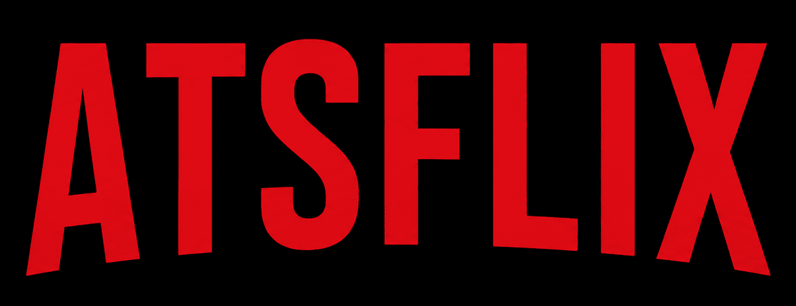

# AtsFlix — Movie & TV Discovery



AtsFlix is a responsive movie and television discovery application built with React, TypeScript and Vite. It uses The Movie Database (TMDB) API to display trending titles, popular and top-rated movies and TV shows, genre/language discovery, and title detail pages.

> AtsFlix is an independent portfolio project. It is not affiliated with, endorsed by, or sponsored by Netflix or TMDB.

## Features

- Browse trending, popular, top-rated and upcoming titles
- Explore movies and TV shows by genre and original language
- View title details, cast, reviews, similar titles and available videos
- Paginated discovery results with load-more functionality
- Client-side sorting and filtering
- Responsive layouts for desktop and mobile
- Shared API client and reusable React components
- TanStack Query caching and request-state management

## Tech stack

- React 19
- TypeScript
- Vite
- React Router
- TanStack Query
- Axios
- Tailwind CSS
- Material UI / Emotion
- Swiper and Lenis

## Getting started

### Requirements

- Node.js 20.19+ or 22.12+
- npm or Bun

### Install

```bash
npm install
```

Or, if using Bun:

```bash
bun install
```

### Configure TMDB

Copy `.env.example` to `.env.local` and add a TMDB API Read Access Token:

```env
VITE_API_KEY=your_tmdb_bearer_token
```

**Security note:** Vite exposes every `VITE_` variable in the browser bundle. Do not treat this value as a private secret. For production, move TMDB requests behind a backend/serverless proxy and keep the access token on the server. Never commit `.env.local`.

### Run locally

```bash
npm run dev
```

### Build

```bash
npm run build
```

### Lint

```bash
npm run lint
```

### Preview the production build

```bash
npm run preview
```

### Optional bundle report

```bash
ANALYZE=true npm run build
```

The bundle report is generated at `dist/bundle-report.html`.

## Environment variables

| Variable | Required | Description |
|---|---:|---|
| `VITE_API_KEY` | Yes | TMDB API Read Access Token; exposed to the browser in this client-only version |

## Project structure

```text
src/
├── API/             # TMDB API client and endpoint functions
├── components/      # Page sections and reusable application components
├── config/          # Navigation, genres, language and content configuration
├── design_system/  # Design-system reference data
├── hooks/           # Reusable React and TanStack Query hooks
├── icons/           # Icon definitions
├── layouts/         # Shared page layouts
├── pages/           # Route-level pages
├── types/           # TypeScript domain types
├── ui/              # Reusable presentation components
└── utility/         # Formatting, filtering and helper functions
```

## Attribution

Movie metadata and artwork are provided by [The Movie Database (TMDB)](https://www.themoviedb.org/). This product uses the TMDB API but is not endorsed or certified by TMDB. Follow TMDB's current branding and attribution requirements before publishing a public deployment.

## Current limitations

- The current frontend calls TMDB directly, so the Vite-prefixed access token is visible to users. A server-side proxy is recommended before production deployment.
- Automated unit and end-to-end tests should be added.
- Production deployment and live demo links will be added after deployment.
